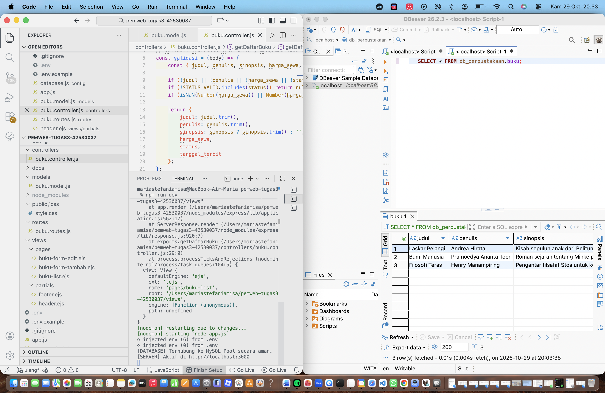
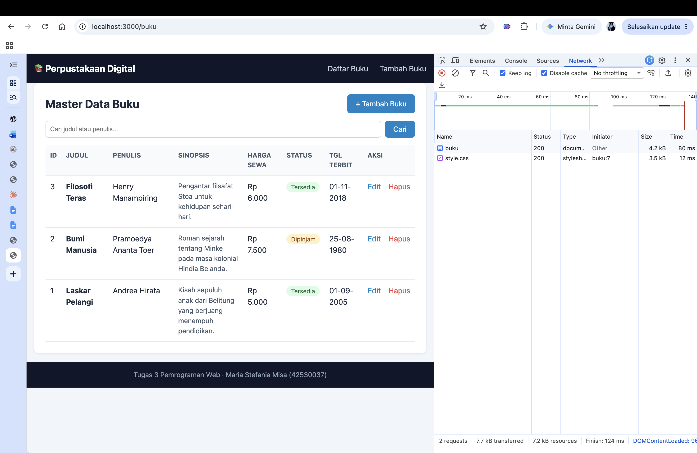
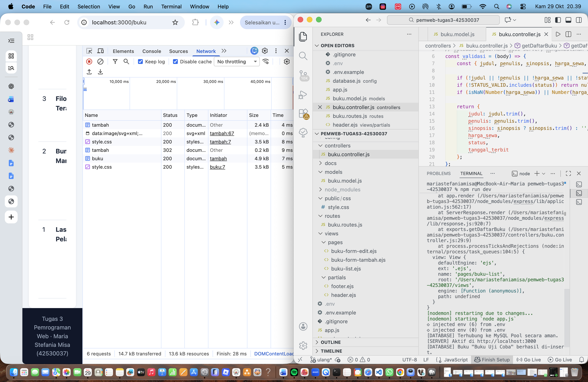
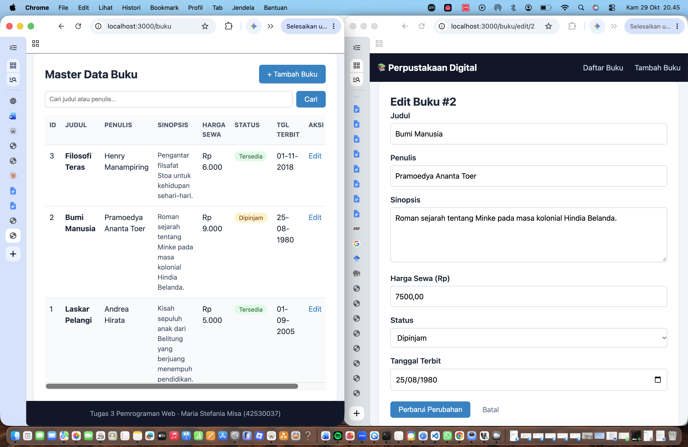
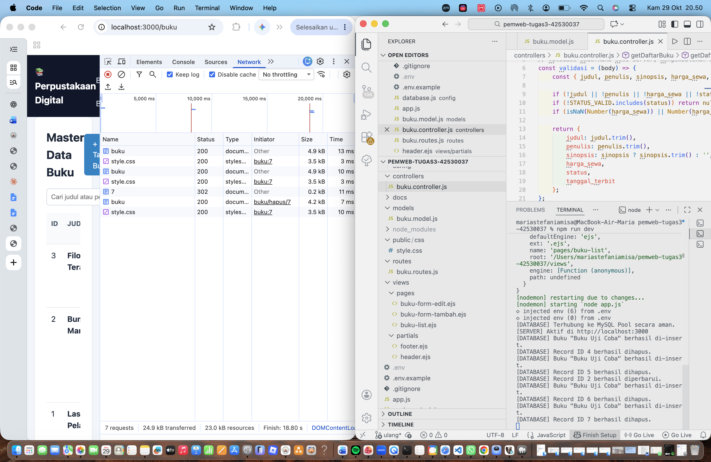
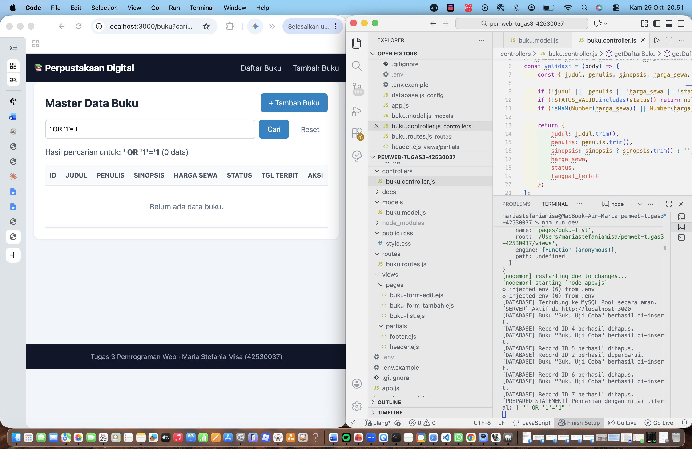

# Tugas 3 Pemrograman Web: Master Data Buku Perpustakaan

Aplikasi CRUD Master Data Buku berbasis Express.js, EJS, dan MySQL
dengan connection pool (mysql2/promise) dan 100% prepared statements.

**Nama:** Maria Stefania Misa    **NIM:** 42530037

## Teknologi
Node.js, Express, EJS, MySQL (MAMP), mysql2, dotenv, nodemon

## Struktur Proyek
```
config/       koneksi pool database
models/       seluruh query SQL (prepared statements)
controllers/  alur data dan validasi
routes/       definisi endpoint
views/        tampilan EJS (pages dan partials)
public/css/   style.css
```

## Skema Tabel `buku`
| Kolom | Tipe |
|---|---|
| id | INT AUTO_INCREMENT PRIMARY KEY |
| judul | VARCHAR |
| penulis | VARCHAR |
| sinopsis | TEXT |
| harga_sewa | DECIMAL |
| status | ENUM('tersedia','dipinjam','rusak') |
| tanggal_terbit | DATE |

Skrip pembuat tabel ada di `database.sql`.

## Cara Menjalankan
1. `npm install`
2. Salin `.env.example` menjadi `.env`, lalu sesuaikan isinya
3. Nyalakan MySQL (MAMP) dan impor `database.sql`
4. `npm run dev`, lalu buka http://localhost:3000/buku

## Matriks Penelusuran Pengujian

| ID Uji | Fitur | Endpoint | Method | Skenario | Hasil yang Diharapkan | Status | Bukti |
|---|---|---|---|---|---|---|---|
| TC-01 | Koneksi Pool | App startup | - | Server dijalankan pertama kali | Terhubung ke MySQL Pool tanpa error | Pass |  |
| TC-02 | Read (All) | /buku | GET | Akses halaman daftar buku | Seluruh record tampil di tabel EJS | Pass |  |
| TC-03 | Create | /buku/tambah | POST | Submit formulir buku baru | Data tersimpan, 302 Redirect ke /buku | Pass |  |
| TC-04 | Update | /buku/edit/:id | POST | Ubah data buku | Nilai kolom di MySQL berubah | Pass |  |
| TC-05 | Delete | /buku/hapus/:id | POST | Klik tombol hapus | Baris terhapus dari MySQL dan UI ter-refresh | Pass |  |
| TC-06 | Keamanan | /buku?cari=... | GET | Input `' OR '1'='1` | Diperlakukan sebagai literal, 0 data (tanpa injection) | Pass |  |

## Catatan Keamanan
Seluruh query (SELECT, INSERT, UPDATE, DELETE) memakai placeholder `?`
dengan `db.execute()`. Kredensial database disimpan di `.env` dan tidak
diunggah ke repositori.
